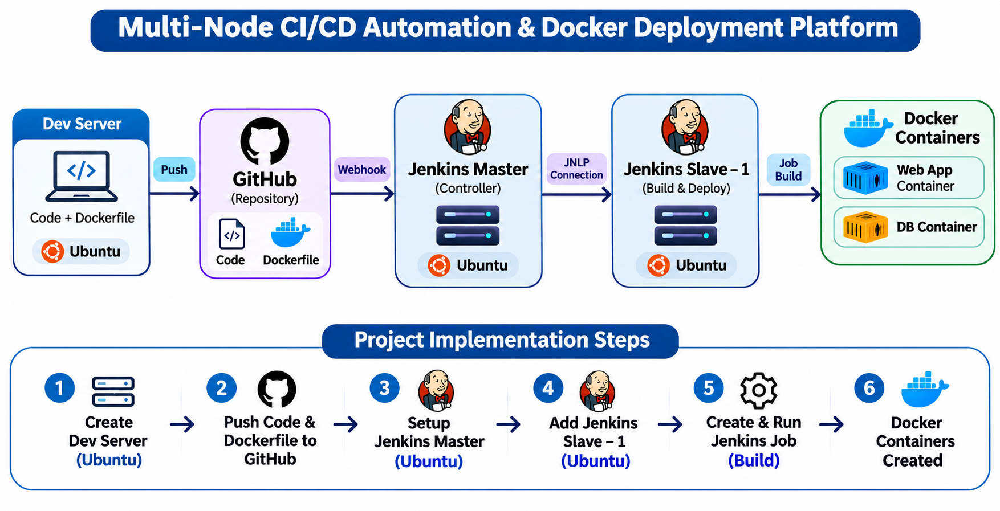
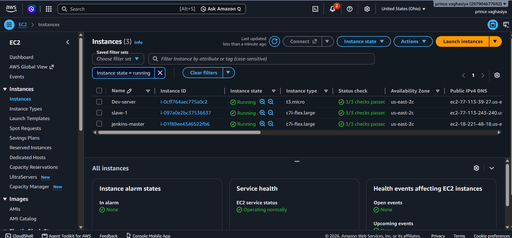
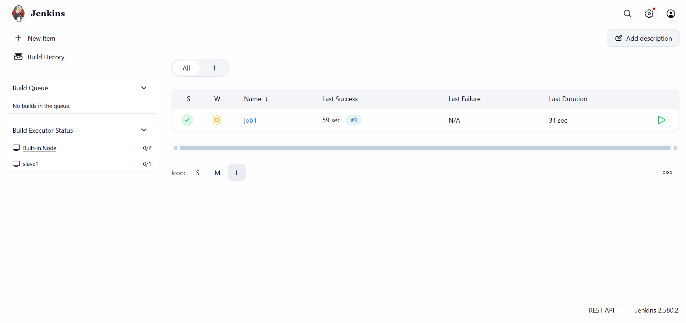
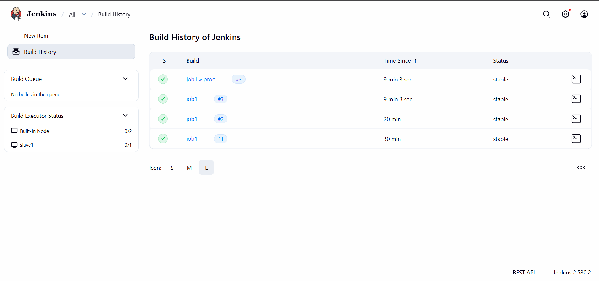

# Multi-Node CI/CD Automation & Docker Deployment Platform

A practical DevOps project demonstrating a multi-node CI/CD workflow using **Ubuntu Linux, Git, GitHub, Jenkins, and Docker**. The project starts with a development server, stores the application code and Dockerfile in GitHub, triggers Jenkins through a webhook, and runs the build job on a dedicated Jenkins agent (Slave 1).

---

## Project Overview

The infrastructure contains three Ubuntu EC2 instances:

| Server | Role |
|---|---|
| Dev-server | Prepare the website source code and Dockerfile, then push them to GitHub |
| jenkins-master | Manage Jenkins jobs and coordinate the agent |
| slave-1 | Connect to the Jenkins Master and execute the configured build job |

The Jenkins agent is connected using the **JNLP agent method**. Docker is used to build and run the application container(s).

## Architecture



## Project Workflow

1. Launch an Ubuntu EC2 instance for the development server.
2. Prepare the website source code and Dockerfile on the Dev-server.
3. Push the code and Dockerfile to the GitHub repository.
4. Launch an Ubuntu EC2 instance for Jenkins Master and configure Jenkins.
5. Launch an Ubuntu EC2 instance for Jenkins Slave 1 and connect it to the Master using the JNLP agent method.
6. Configure Jenkins job `job1` to run on `slave1`.
7. Trigger/run the job and verify the build result and Docker container(s).

## Implementation Screenshots

### 1. Website source project

The website template and its source files are stored in the project repository.


### 2. AWS EC2 infrastructure

Three Ubuntu EC2 instances are used: `Dev-server`, `jenkins-master`, and `slave-1`.



### 3. Jenkins dashboard and agent

The Jenkins dashboard shows the configured `job1` job and the `slave1` build executor.



### 4. Jenkins build history

The build history screenshot shows successful builds for `job1`.



## Technology Stack

- **Operating System:** Ubuntu Linux
- **Cloud Platform:** AWS EC2
- **Version Control:** Git
- **Source Code Hosting:** GitHub
- **Automation Server:** Jenkins
- **Agent Connection:** Jenkins JNLP
- **Containerization:** Docker
- **Frontend:** HTML, CSS, JavaScript

## Repository Structure

```text
Multi-Node-CI-CD-Automation-Docker-Deployment-Platform/
├── Images/
├── assets/
│   ├── architecture.png
│   ├── 01-website-template.png
│   ├── 02-aws-ec2-instances.png
│   ├── 03-jenkins-dashboard.png
│   └── 04-jenkins-build-history.png
├── Dockerfile
├── index.html
├── tooplate-2167-orbital-script.js
├── tooplate-2167-orbital-style.css
└── README.md
```

## Jenkins Job

The Jenkins dashboard screenshot shows a job named **`job1`**. The job is configured to execute on the Jenkins agent `slave1`.

Typical job stages:

1. Check out the project source from GitHub.
2. Execute the configured build commands on the agent.
3. Build the Docker image from the repository Dockerfile.
4. Run and verify the application container.

> The exact build commands and container settings depend on the Dockerfile and the commands configured in your Jenkins job.

## Docker Verification Commands

Run these commands on the Ubuntu machine where the Jenkins job executes and Docker is installed:

```bash
# Check Docker
docker --version

# Build an image from the Dockerfile
docker build -t my-web-app .

# Run the application container (adjust ports if your Dockerfile requires it)
docker run -d --name my-web-app -p 80:80 my-web-app

# List running containers
docker ps

# View container logs
docker logs my-web-app
```

## Prerequisites

- AWS account with permission to launch EC2 instances.
- Three Ubuntu EC2 instances: Dev-server, Jenkins Master, and Slave 1.
- GitHub repository containing the website source and Dockerfile.
- Jenkins installed and configured on the Master.
- Java runtime and required build tools on the Jenkins agent.
- Docker installed on the node that performs the Docker build.
- Network/security-group rules configured for the required SSH, Jenkins, GitHub webhook, and agent communication.

## What I Learned

- Launching and managing multiple Ubuntu EC2 instances.
- Using Git and GitHub for source-code version control.
- Configuring a Jenkins Master-Agent architecture.
- Connecting a Jenkins agent through the JNLP method.
- Assigning a Jenkins job to a specific agent.
- Building and running Docker containers as part of a CI workflow.
- Checking Jenkins build status and troubleshooting server connectivity.

## Future Enhancements

- Convert the freestyle job into a declarative `Jenkinsfile` pipeline.
- Add automated testing before the Docker build.
- Push versioned Docker images to a container registry.
- Add deployment automation, health checks, and rollback.
- Add monitoring and build notifications.

## Author

**Prince Vaghasiya**

---

If you find this project useful, feel free to ⭐ the repository.
